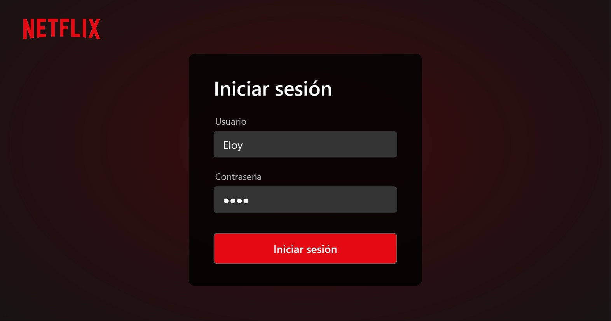
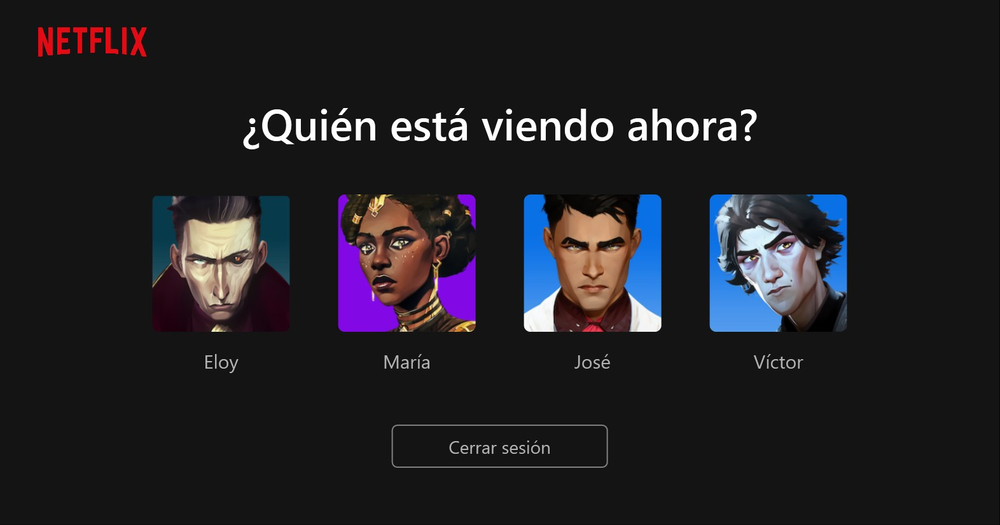
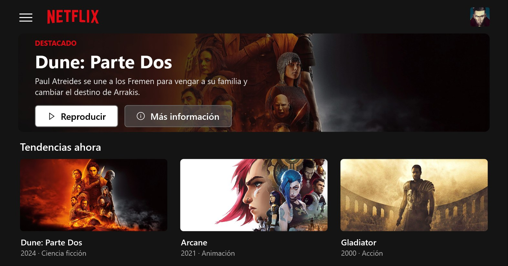
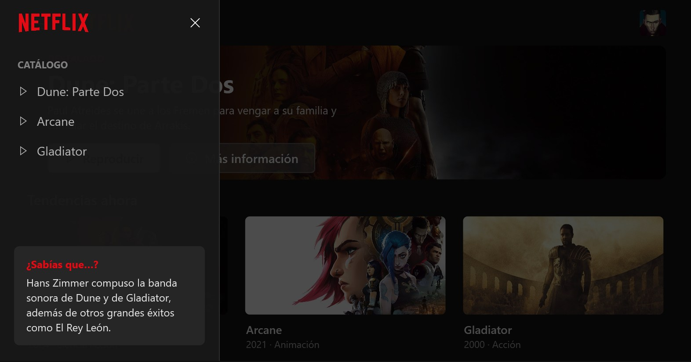
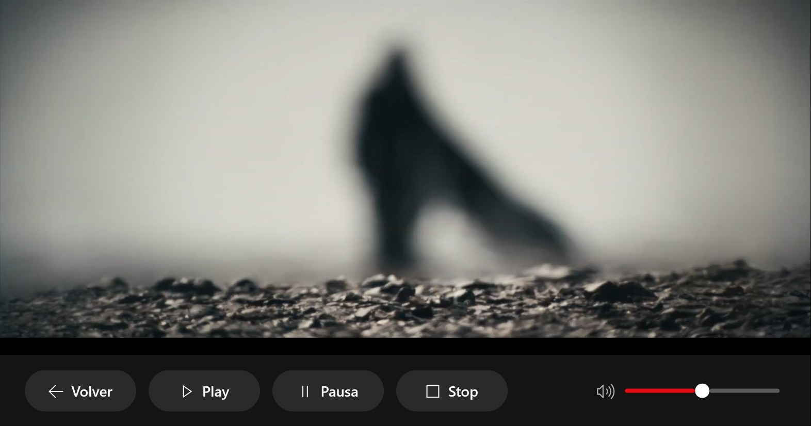

# 🎬 Netflix UI Clone · C# WPF

Aplicación de escritorio inspirada en **Netflix**, desarrollada como **Práctica 2** de la asignatura **Interfaces de Usuario** (UMH, curso 2024/25). Está hecha con **WPF** y **XAML** sobre **.NET Framework 4.7.2** y recorre el flujo completo: inicio de sesión, selección de perfil, catálogo y reproductor de vídeo.

## 📸 Capturas

| Inicio de sesión | Selección de perfil |
|:---:|:---:|
|  |  |

| Catálogo | Menú lateral animado |
|:---:|:---:|
|  |  |

| Reproductor |
|:---:|
|  |

## ✨ Características

- 🔐 **Inicio de sesión** con validación de campos vacíos y de credenciales (usuario de demostración: `Eloy` / `1234`)
- 👥 **Selección de perfil** ("¿Quién está viendo ahora?") con animación de escala al pasar el ratón
- 🎞️ **Catálogo** con título destacado y fila de carátulas; al elegir una se abre su reproductor
- ▶️ **Reproductor** con `MediaElement`: Play, Pausa, Stop y control de **volumen** enlazado por *data binding*
- 📂 **Menú lateral deslizante** animado con `Storyboard`, con acceso directo a cada título
- 🎨 **Estilos y plantillas propias** centralizados en `App.xaml`: tarjetas con zoom, botones con icono (`ControlTemplate` + `Tag`), campos de texto y control de volumen, con `Triggers` para los estados *hover*, *pressed* y foco
- 🔁 **Cambio de modo solo con XAML**: el catálogo y el reproductor se alternan mediante *bindings* y `DataTrigger` sobre la visibilidad, sin lógica adicional en C#

## 📁 Estructura del proyecto

```
NetflixClone.sln
NetflixClone/
├── App.xaml                 ← punto de entrada, paleta y estilos compartidos
├── log.xaml / .cs           ← ventana de inicio de sesión
├── MainWindow.xaml / .cs    ← selección de perfil y contenedor (Frame) de navegación
├── Page1.xaml / .cs         ← catálogo, menú lateral y reproductores
├── Properties/              ← metadatos del ensamblado
└── *.png / *.jpg            ← recursos gráficos de la interfaz
docs/                        ← capturas de este README
```

## 🛠️ Tecnologías


## 🎯 Conceptos aplicados

- Diseño declarativo de interfaces con **XAML** (`Grid`, `Frame`, `Page`, `Popup`)
- **Estilos**, **`ControlTemplate`** y **`Triggers`** para personalizar controles
- **Animaciones** con `Storyboard`, `DoubleAnimation` y transformaciones (`ScaleTransform`, `TranslateTransform`)
- **Navegación** entre ventanas y páginas
- **Data binding** entre controles (`Slider` ↔ `MediaElement.Volume`)
- Reproducción multimedia con `MediaElement` en modo manual

## 🚀 Cómo ejecutar

1. Abrir `NetflixClone.sln` con **Visual Studio 2019/2022** (carga de trabajo *Desarrollo de escritorio de .NET*).
2. Compilar y ejecutar con `F5`.

> 🎥 Los vídeos no se incluyen en el repositorio. Para probar el reproductor, crea la carpeta `NetflixClone/Videos/` y añade tus propios `Dune2.mp4`, `arcane.mp4` y `Gladiator.mp4`; el proyecto los copia a la salida si existen y compila igualmente sin ellos.

---

📌 *Práctica académica sin ánimo de lucro. Netflix y las imágenes de las obras mostradas pertenecen a sus respectivos propietarios y se usan solo con fines educativos.*
